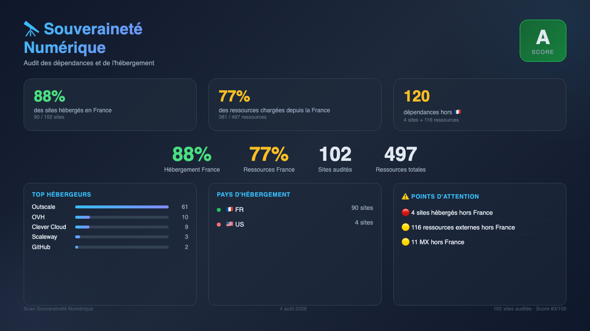

# Scan Souveraineté

Audit de souveraineté numérique pour un parc de sites web.

Pour chaque URL, le scan détermine où sont hébergés le serveur, les serveurs MX, et chaque ressource externe (scripts, polices, images, etc.) — et produit un résumé avec le score "France" et les dépendances non‑françaises.



## Quick start

```bash
docker compose build
docker compose run --rm scan
```

Le rapport HTML est généré avec :

```bash
npm run build && npm run report
```

## Résultat

Un résumé JSON dans `output/results/_summary.json` :

```json
"hosting": { "FR": 25, "US": 3 },
"non_fr_hosted_urls": [{ "url": "https://...", "organization": "Amazon Web Services", "country": "US" }]
```

## Scripts

| Commande         | Description                           |
| ---------------- | ------------------------------------- |
| `npm start`      | Lance le scan                         |
| `npm run report` | Génère `output/report.html`           |
| `npm run social` | Génère `output/social.png` (1200×675) |
| `npm run clean`  | Supprime les artefacts                |

## Documentation

Voir [`specs.md`](specs.md) pour l'architecture complète, la structure des données et la configuration.
